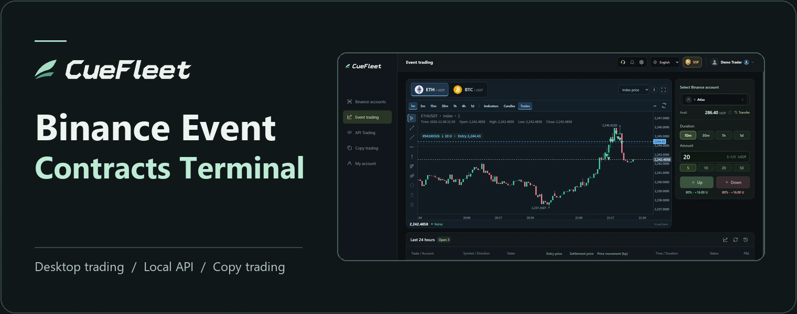
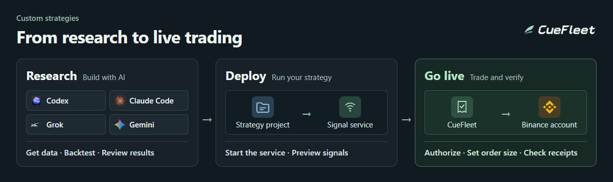
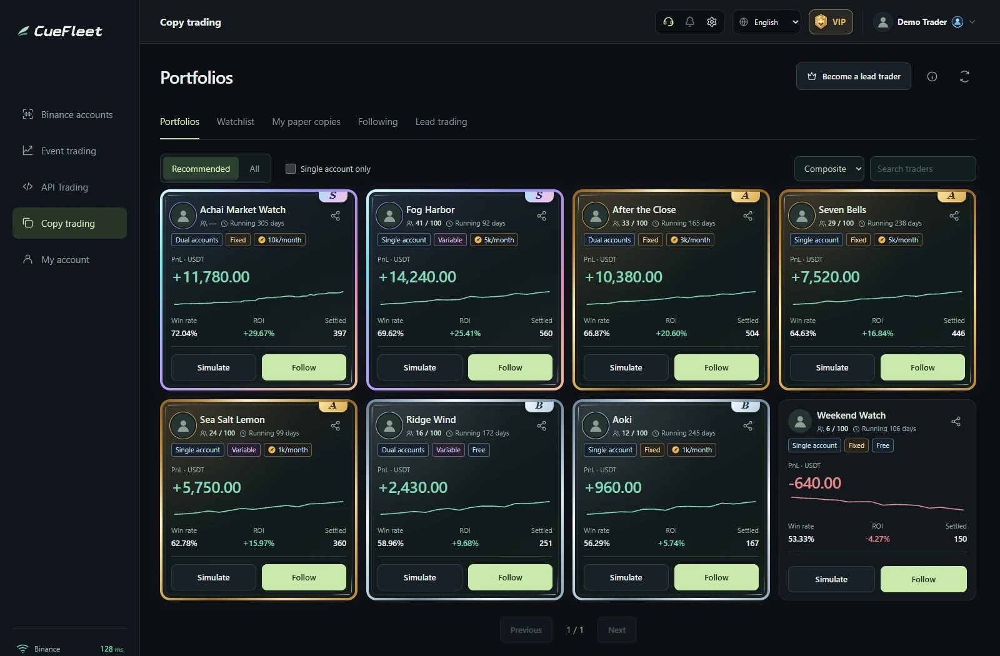
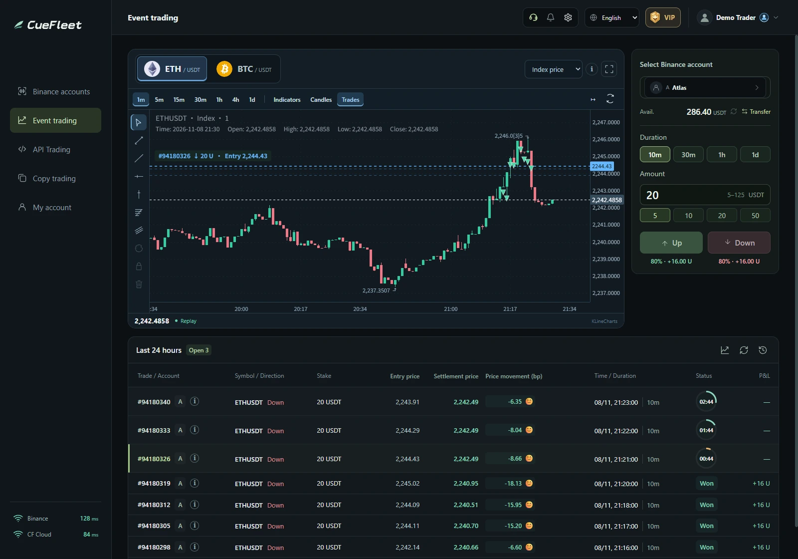

# CueFleet · Binance Event Contract Trading

**Trade Binance event contracts with CueFleet. Place trades from your desktop, follow live projects, or connect your own strategy.**

**[Download for Windows](https://cuefleet.com/download/windows)** · **[Download Linux .deb](https://cuefleet.com/download/linux-deb)** · **[Linux setup guide](docs/linux.en.md)** · [Website](https://cuefleet.com/website/en.html) · <a href="https://t.me/lazyer_trading" title="Contact @lazyer_trading on Telegram"> Telegram</a> · [Discord](https://discord.gg/phjusp8TT) · [简体中文](README.md)

## Features

- **Desktop trading**　View BTC and ETH index charts, place orders, track open positions and see settlement results in one workspace.
- **Live copy trading**　Review lead traders' performance and order history, subscribe, then link an authorized account and choose your order size.
- **Custom strategies**　Use the open-source Skill to fetch market data, backtest and export a signal service. Run your execution program on the same machine and connect it to the CueFleet local trading API to place live orders and check receipts.

**[Watch the product tutorial](https://cuefleet.com/website/en.html#video)** · [Explore the copy trading marketplace](https://cuefleet.com/website/en.html#leaders) · [Create a CueFleet account](https://cuefleet.com/register#lang=en)

## From research to live trading

**[Live trading guide](https://github.com/CueFleet/event-contract-skill/blob/main/docs/quickstart.md#实盘接入)** · [Open-source strategy Skill](https://github.com/CueFleet/event-contract-skill) · [Historical market data case study](https://github.com/CueFleet/event-contract-skill/blob/main/docs/btc-volume-breakout.md)

## Client preview

Project figures are shown for demonstration.

See the trading workspace

The product demo uses historical prices and example orders.

## Installation and support

- **Windows x64**　Download and run the installer.
- **Ubuntu 24.04 x86-64**　Install the `.deb` with APT, set a window password with `cuefleet setup --set-password`, and run `cuefleet start`. [See the Linux quick start](docs/linux.en.md)

Get help through <a href="https://t.me/lazyer_trading"> Telegram @lazyer_trading</a>, [website support](https://cuefleet.com/website/en.html#help), [Discord](https://discord.gg/phjusp8TT), or [email](mailto:support@cuefleet.com).

CueFleet is third-party software. Binance sets trading eligibility. Event contract trading can result in losses, and past performance does not predict future returns.
