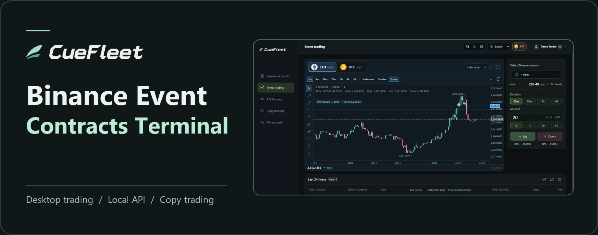
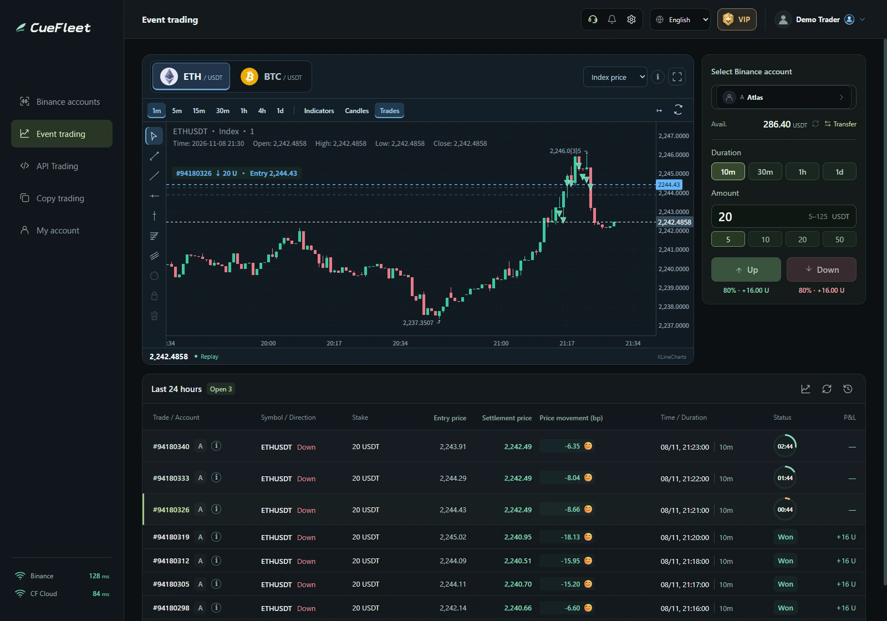

# CueFleet · Binance Event Contract Trading

**Desktop trading, local API access and copy trading in one client.**

**[Download for Windows](https://cuefleet.com/download/windows)** · **[Download Linux .deb](https://cuefleet.com/download/linux-deb)** · **[Linux setup guide](docs/linux.en.md)** · [Website](https://cuefleet.com/website/en.html) · [Discord](https://discord.gg/phjusp8TT) · [简体中文](README.md)

## Features

- **Desktop trading**　View BTC and ETH index charts, place orders, track open positions and see settlement results in one workspace.
- **API trading**　Enable the local API while the client is running so your strategy can query accounts, submit orders and check receipts. Find the API reference in the client.
- **Copy trading**　Compare project performance, try paper following or subscribe in the client. You can also apply to lead a project and earn a share of eligible subscription fees.

[Explore the copy trading marketplace](https://cuefleet.com/website/en.html#leaders) · [Create a CueFleet account](https://cuefleet.com/register#lang=en)

See the trading workspace

The product demo uses historical prices and example orders.

## Installation and support

- **Windows x64**　Download and run the installer.
- **Ubuntu 24.04 x86-64**　Install the `.deb` with APT and run `cuefleet setup`. [See the Linux quick start](docs/linux.en.md).

Get help through [website support](https://cuefleet.com/website/en.html#help), [Discord](https://discord.gg/phjusp8TT) or [email](mailto:support@cuefleet.com).

CueFleet is third-party software. Binance sets trading eligibility. Event contract trading can result in losses, and past performance does not predict future returns.
