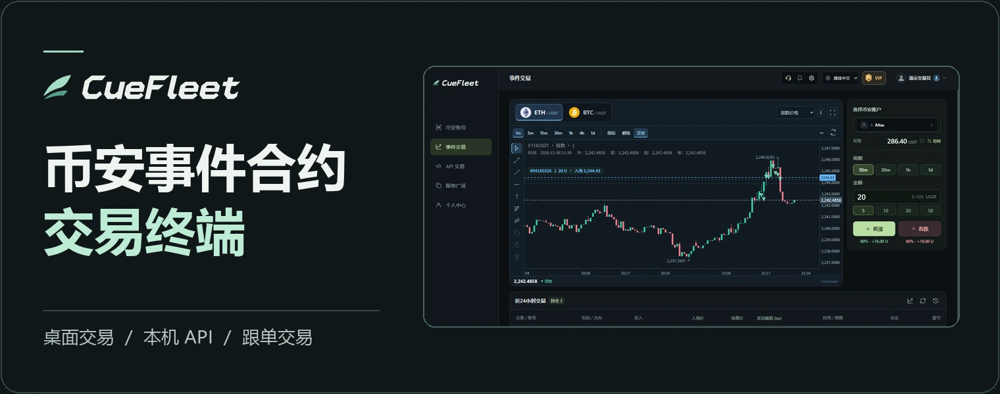
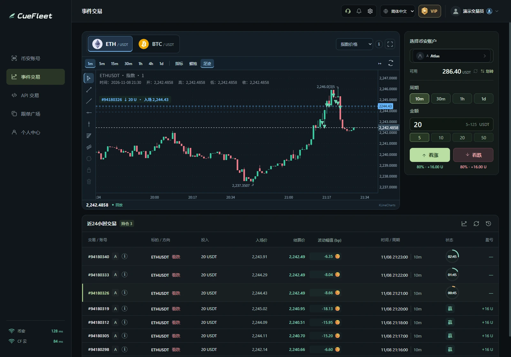

# CueFleet · 币安事件合约交易

**在一个客户端完成桌面交易、接入本机 API 和跟单。**

**[下载 Windows](https://cuefleet.com/download/windows)** · **[下载 Linux](https://cuefleet.com/download/linux)** · **[Linux 使用教程](docs/linux.md)** · [访问官网](https://cuefleet.com/) · [加入 Discord](https://discord.gg/phjusp8TT) · [English](README.en.md)

## 产品功能

- **桌面交易**　查看 BTC、ETH 指数 K 线，在同一个界面下单、跟踪持仓和查看结算。
- **API 交易**　客户端运行时可开启本机 API，让自己的策略查询账户、提交订单和读取回执。接口文档内置于客户端。
- **跟单广场**　查看项目表现，先模拟跟随，或在客户端订阅项目。也可以申请成为带单员，获得符合条件的订阅分润。

[浏览跟单广场](https://cuefleet.com/#leaders) · [注册 CueFleet](https://cuefleet.com/register)

查看交易界面

界面为功能演示，使用历史行情和示例订单。

## 安装与支持

- **Windows x64**　下载安装包，按提示完成安装。
- **Linux x86-64**　解压后直接运行 `sh ./setup.sh`，由向导处理系统权限。[查看 Linux 快速开始](docs/linux.md)。

使用中遇到问题，可以通过[官网在线客服](https://cuefleet.com/#help)、[Discord 社区](https://discord.gg/phjusp8TT)或[邮件](mailto:support@cuefleet.com)联系。

CueFleet 是第三方软件。交易资格以币安规则为准。事件合约可能亏损，历史表现不代表未来收益。
