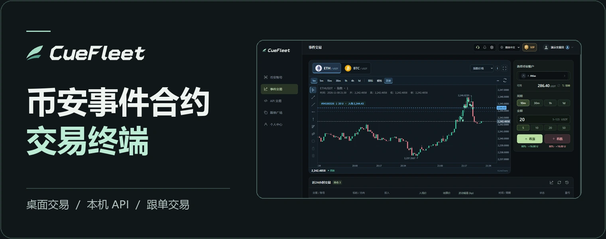
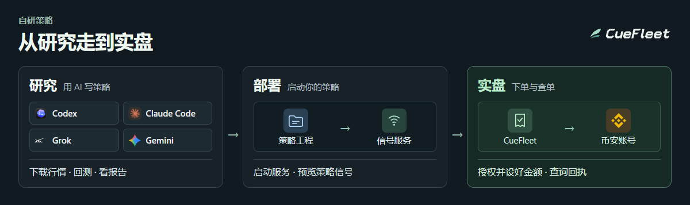
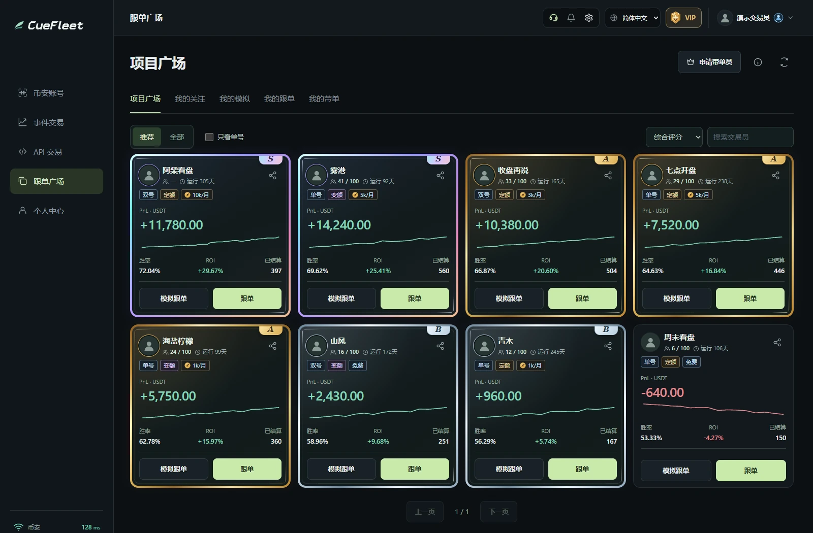
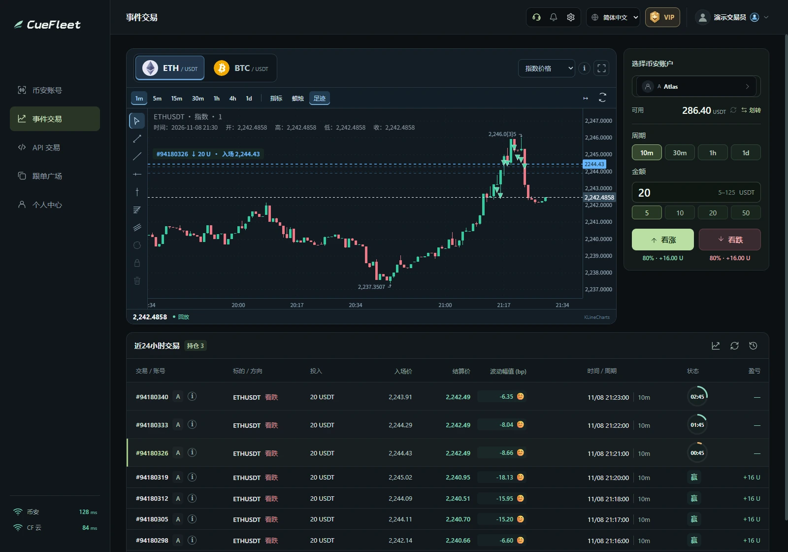

# CueFleet · 币安事件合约交易

**用 CueFleet 交易币安事件合约。支持桌面下单、实盘跟单，也能把自研策略接进实盘。**

**[下载 Windows](https://cuefleet.com/download/windows)** · **[下载 Linux .deb](https://cuefleet.com/download/linux-deb)** · **[Linux 使用教程](docs/linux.md)** · [访问官网](https://cuefleet.com/) · [加入 Discord](https://discord.gg/phjusp8TT) · [English](README.en.md)

## 产品功能

- **桌面交易**　查看 BTC、ETH 指数 K 线，在同一个界面下单、跟踪持仓和查看结算。
- **实盘跟单**　在项目广场查看带单员的业绩与订单，订阅后绑定授权账号，设置跟单金额并核对交易记录。
- **自研策略**　用开源 Skill 下载行情、回测和导出信号服务。通过部署在同一台机器的执行程序接入 CueFleet 本机交易 API，提交实盘订单并查询回执。

**[观看产品教程](https://cuefleet.com/#video)** · [浏览跟单广场](https://cuefleet.com/#leaders) · [注册 CueFleet](https://cuefleet.com/register)

## 从研究到实盘

**[实盘接入指南](https://github.com/CueFleet/event-contract-skill/blob/main/docs/quickstart.md#实盘接入)** · [开源策略 Skill](https://github.com/CueFleet/event-contract-skill) · [真实行情案例](https://github.com/CueFleet/event-contract-skill/blob/main/docs/btc-volume-breakout.md)

## 客户端预览

图中项目数据为界面演示。

查看交易界面

界面为功能演示，使用历史行情和示例订单。

## 安装与支持

- **Windows x64**　下载安装包，按提示完成安装。
- **Ubuntu 24.04 x86-64**　用 APT 安装 `.deb`，运行 `cuefleet setup --set-password` 设置锁屏密码，再运行 `cuefleet start`。[查看 Linux 快速开始](docs/linux.md)

使用中遇到问题，可以通过 [Telegram @lazyer_trading](https://t.me/lazyer_trading)、[官网在线客服](https://cuefleet.com/#help)、[Discord 社区](https://discord.gg/phjusp8TT)或[邮件](mailto:support@cuefleet.com)联系。

CueFleet 是第三方软件。交易资格以币安规则为准。事件合约可能亏损，历史表现不代表未来收益。
