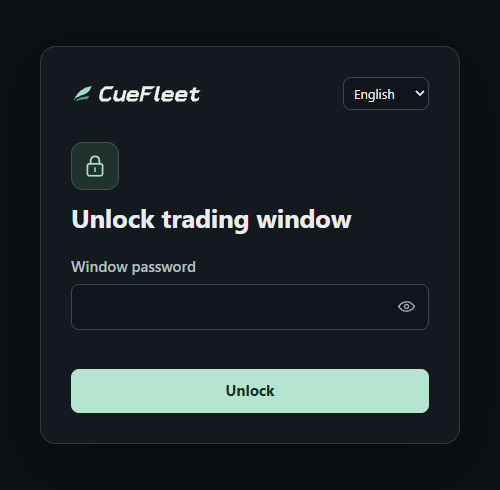

# Linux WebUI Setup Guide

[简体中文](linux.md) · [Project homepage](../README.en.md)

Ubuntu 24.04 (x86-64)

## 1. Install

```bash
curl -fL https://cuefleet.com/download/linux-deb -o CueFleet-linux-amd64.deb
sudo apt install ./CueFleet-linux-amd64.deb
```

Install with `sudo`, then configure and start CueFleet as the same regular user. [SHA-256 checksum](https://cuefleet.com/download/linux-deb.sha256)

## 2. Set a password and start

Pick one option. Use a window password of at least 6 characters. The terminal asks for it twice and hides your input.

**On the server**

```bash
cuefleet setup --ssl off --set-password && cuefleet start
```

Open `http://127.0.0.1:19425/` in the server’s browser.

**From a phone or another computer**

```bash
cuefleet setup --ssl auto --set-password && cuefleet start
```

Allow inbound TCP `80` and `19425`, then open the HTTPS address printed in the terminal.

## 3. Open WebUI

Enter the window password in the unlock dialog, then sign in to CueFleet. The profile menu offers **Lock window** and **Switch CueFleet account**. After setup, use `cuefleet start` to start and `Ctrl+C` to stop.



## More settings

<details>
<summary>Password, idle timeout, and current settings</summary>

```bash
cuefleet setup --set-password
cuefleet setup --idle-minutes 30
cuefleet setup --show
```

If you forget the password, reset it. The idle timeout defaults to **10 minutes** and accepts 1–120 minutes. CueFleet keeps running while the window is locked. The settings view shows whether a password is set. Restart to apply changes.

</details>

<details>
<summary>Port and IP allowlist</summary>

```bash
cuefleet start --port 19426
cuefleet setup --ip-allowlist '203.0.113.10,198.51.100.0/24'
cuefleet setup --ip-allowlist off
```

The default port is `19425`. Choose any port from `1024–65535` and allow it through the firewall for remote access. The allowlist is off by default and accepts IPv4, IPv6, and network ranges. Replace the examples with the source addresses you want to allow.

</details>

<details>
<summary>HTTPS certificates and port 80</summary>

`--ssl auto` detects the server’s public IPv4 address and handles issuance and renewal. Allow inbound public TCP `80` in the cloud and server firewalls. If a website already uses port 80, configure it to serve `/.well-known/acme-challenge/` from `/var/lib/cuefleet-webui-acme` with the URL path intact, then run:

```bash
cuefleet setup --ssl auto --acme-webroot
```

To use your own certificate:

```bash
cuefleet setup --ssl custom --host cf.example.com \
  --cert /path/to/fullchain.pem --key /path/to/privkey.pem
```

The certificate must match the domain or IP you open. If configuring from a root shell, make sure the `cuefleet-webui` user can read the PEM files and traverse their parent directories.

</details>

<details>
<summary>Use the portable archive</summary>

[Download the .tar.gz](https://cuefleet.com/download/linux), extract it, and run this in the installation directory:

```bash
sh ./setup.sh --set-password && sh ./start.sh
```

Setup accepts the same options as `cuefleet setup`.

</details>

Run `cuefleet setup --help` or `cuefleet start --help` for the full list of options. Add `--lang en` to show setup output in English.
