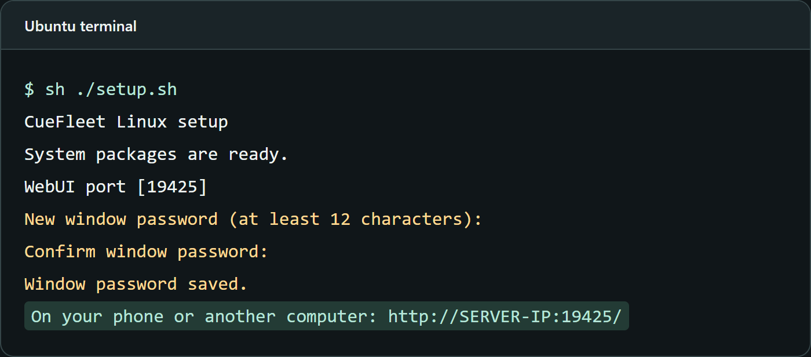
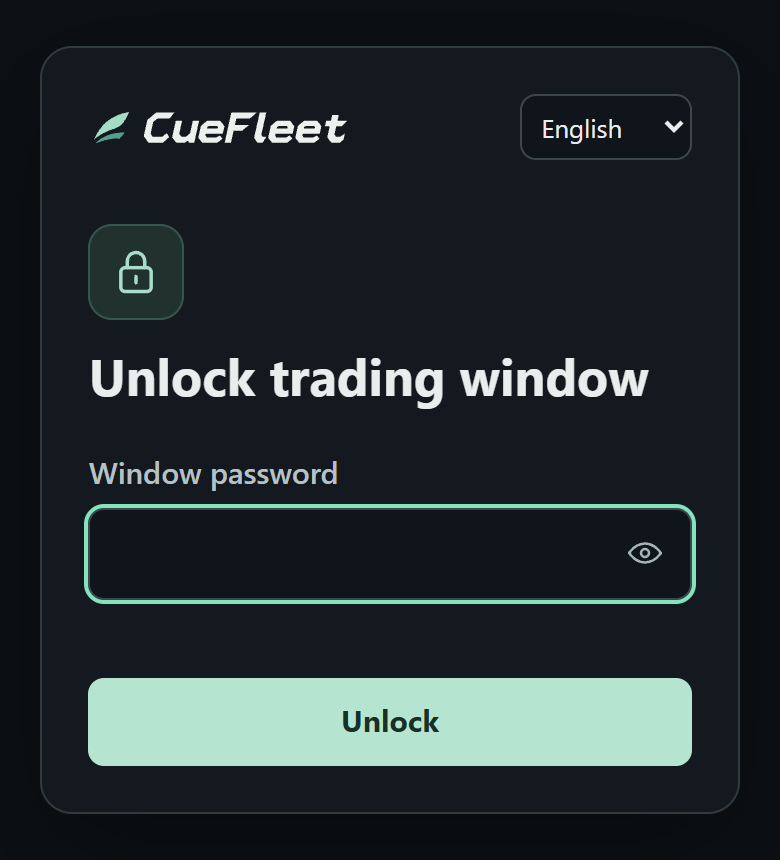
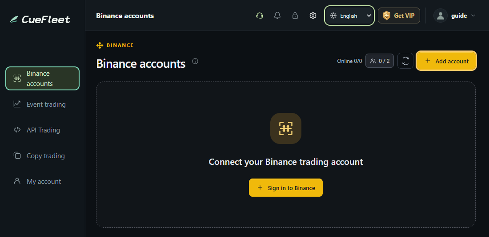
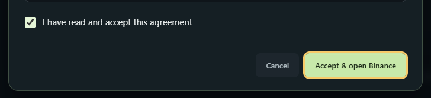

# Linux WebUI Setup Guide

[简体中文](linux.md) · [Back to the project](../README.en.md)

Requires **Ubuntu 24.04 (x86-64)**. Install on the server, then open WebUI from your computer or phone.

## 1. Install CueFleet

Sign in to the server as a regular user with sudo access and run these commands in an empty directory.

```bash
curl -fL https://cuefleet.com/download/linux -o CueFleet-Linux-x64.tar.gz &&
tar -xzf CueFleet-Linux-x64.tar.gz &&
cd CueFleet-Linux-x64 &&
sh ./setup.sh
```

Set a window password when prompted. Leave the terminal open after startup.



## 2. Open WebUI in your browser

Open the address shown by the wizard on your computer or phone, for example `http://SERVER_IP:19425/`. Enter the window password. The default port is `19425`.



Allow the selected TCP port in your firewall only from the connecting device’s public IP. **Public HTTP is unencrypted. Use a trusted encrypted connection to sign in or trade.**

## 3. Add a Binance account

On the server, open `http://127.0.0.1:19425/` in a browser. For remote sign-in, use trusted HTTPS. Then open **Binance Accounts → Add account**, accept the agreement, and complete sign-in in the official Binance window.





<details>
<summary>Configure HTTPS with an existing trusted certificate</summary>

Stop the running client. Replace the domain and certificate paths, then run:

```bash
CUEFLEET_HTTPS_HOST=your-domain.example \
CUEFLEET_HTTPS_CERT=/path/to/fullchain.pem \
CUEFLEET_HTTPS_KEY=/path/to/privkey.pem \
sh ./start.sh
```

Open `https://your-domain.example:19425/`. If you use a custom port, use that same port to start the client and open the page.

</details>

See the included `README.md` for upgrades and manual startup.
