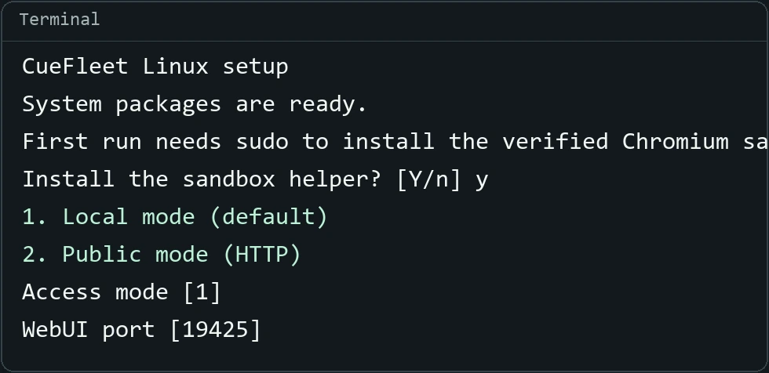

# CueFleet Linux WebUI Setup Guide

[简体中文](linux.md) · [Back to the project](../README.en.md)

Run CueFleet on an **Ubuntu 24.04 (x86-64)** server and open WebUI in your own browser.

## 1. Install

[Download 0.5.68](https://cuefleet.com/downloads/linux/CueFleet-0.5.68-linux-x64.tar.gz) · [SHA-256 checksum](https://cuefleet.com/downloads/linux/CueFleet-0.5.68-linux-x64.tar.gz.sha256)

Sign in to the server as a regular user with sudo access and run these commands in an empty directory. If you already uploaded the archive, skip the download command.

```bash
curl -fLO https://cuefleet.com/downloads/linux/CueFleet-0.5.68-linux-x64.tar.gz
tar -xzf CueFleet-0.5.68-linux-x64.tar.gz
cd CueFleet-Linux-x64
sh ./setup.sh
```

The wizard checks dependencies and starts CueFleet. Leave the terminal open and save the restart command.

## 2. Open WebUI



**Local mode (default)**. Run the SSH forwarding command shown by the wizard on your own computer. Leave that terminal open and visit [http://127.0.0.1:19425/](http://127.0.0.1:19425/) in your browser.

```bash
ssh -N -L 19425:127.0.0.1:19425 user@server
```

The example uses the default port. Replace `user@server` with your SSH username and server address. If CueFleet runs on your Linux desktop, open the browser address directly.

**Public mode (HTTP)**. Confirm the public IPv4 address suggested by the wizard or enter it from your hosting dashboard. Set a window password and an idle lock timeout. In the firewall, allow the displayed TCP port only from the public IP of the computer you are connecting from and open the address shown by the wizard. The public IP and the server’s loopback address share the same port. Both require the window password and lock after inactivity.

Both modes default to WebUI port `19425`. If you change it, use the port shown by the wizard. **Public HTTP sends passwords and sessions without encryption, so use Local mode with SSH forwarding for encrypted remote access.**

## 3. Connect Binance

Sign in to CueFleet and open **Binance Accounts → Add Account**. Accept the agreement, open another terminal on the server, and run this command from the client directory:

```bash
sh ./start.sh --binance-login
```

Copy the printed SSH command into a terminal on your own computer and replace `SERVER` with your SSH server address. Connect your VNC viewer to `127.0.0.1` on port `5901` and sign in through the official Binance window. This temporary port is separate from WebUI and does not need to be open on the server. On a Linux desktop, run the printed `vncviewer` command directly. If needed, install the viewer with `sudo apt install tigervnc-viewer`.

See `README.md` in the archive for manual startup, password resets, and upgrades that preserve your settings.
