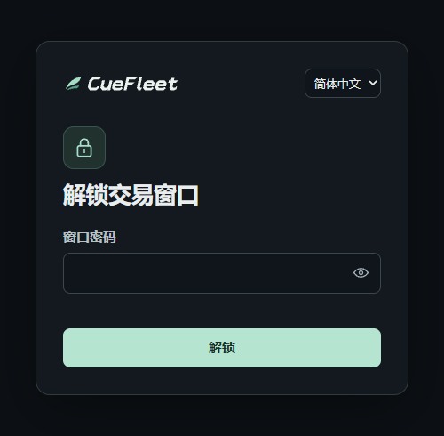

# Linux WebUI 使用教程

[English](linux.en.md) · [项目主页](../README.md)

Ubuntu 24.04（x86-64）

## 1. 安装

```bash
curl -fL https://cuefleet.com/download/linux-deb -o CueFleet-linux-amd64.deb
sudo apt install ./CueFleet-linux-amd64.deb
```

普通用户用 `sudo` 安装。接下来的配置和启动都用同一个普通用户执行。[SHA-256 校验文件](https://cuefleet.com/download/linux-deb.sha256)

## 2. 设置密码并启动

任选一种方式。锁屏密码至少 6 个字符，终端会提示输入两次并隐藏输入。

**服务器本机访问**

```bash
cuefleet setup --ssl off --set-password && cuefleet start
```

在服务器的浏览器打开 `http://127.0.0.1:19425/`。

**手机或其他电脑访问**

```bash
cuefleet setup --ssl auto --set-password && cuefleet start
```

放行 TCP `80` 和 `19425`，在浏览器打开终端显示的 HTTPS 地址。

## 3. 打开 WebUI

在锁屏弹窗输入刚设置的密码，再登录 CueFleet。右上角头像菜单提供「锁定窗口」和「切换 CueFleet 账号」。日常启动只需 `cuefleet start`，按 `Ctrl+C` 停止。



## 详细设置

<details>
<summary>改密码、锁屏时间和查看配置</summary>

```bash
cuefleet setup --set-password
cuefleet setup --idle-minutes 30
cuefleet setup --show
```

忘记密码时可直接重设。锁屏默认 **10 分钟**，可设 1–120 分钟。锁屏期间 CueFleet 继续在后台运行。查看配置时只显示密码是否已设置。修改后重启生效。

</details>

<details>
<summary>端口和 IP 白名单</summary>

```bash
cuefleet start --port 19426
cuefleet setup --ip-allowlist '203.0.113.10,198.51.100.0/24'
cuefleet setup --ip-allowlist off
```

端口默认 `19425`，可用 `1024–65535`。远程访问时也要放行所选端口。白名单默认关闭，支持 IPv4、IPv6 和网段。请把示例地址换成允许访问 WebUI 的来源地址。

</details>

<details>
<summary>HTTPS 证书与 80 端口</summary>

`--ssl auto` 会识别服务器公网 IPv4，自动申请和续期。云安全组和系统防火墙都需要放行公网入站 TCP `80`。若已有网站使用该端口，让它从 `/var/lib/cuefleet-webui-acme` 提供 `/.well-known/acme-challenge/`，保留原 URL 路径，再运行：

```bash
cuefleet setup --ssl auto --acme-webroot
```

也可以使用自己的证书：

```bash
cuefleet setup --ssl custom --host cf.example.com \
  --cert /path/to/fullchain.pem --key /path/to/privkey.pem
```

证书须匹配访问用的域名或 IP。用 root 配置时，需让运行 CueFleet 的 `cuefleet-webui` 用户能读取 PEM 文件并访问其上级目录。

</details>

<details>
<summary>使用便携压缩包</summary>

[下载 .tar.gz](https://cuefleet.com/download/linux)，解压后在安装目录运行：

```bash
sh ./setup.sh --set-password && sh ./start.sh
```

配置参数与 `cuefleet setup` 相同。

</details>

运行 `cuefleet setup --help` 或 `cuefleet start --help` 查看完整用法。添加 `--lang zh` 可用中文显示配置输出。
