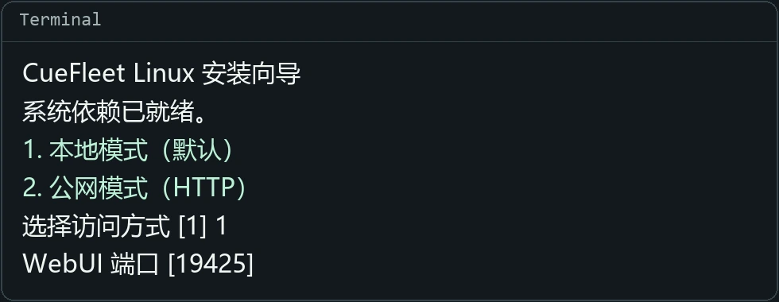

# CueFleet Linux WebUI 使用教程

[English](linux.en.md) · [返回项目主页](../README.md)

在 **Ubuntu 24.04（x86-64）** 服务器运行 CueFleet，用自己电脑的浏览器打开。

## 1. 安装

[下载 0.5.68](https://cuefleet.com/downloads/linux/CueFleet-0.5.68-linux-x64.tar.gz) · [SHA-256 校验文件](https://cuefleet.com/downloads/linux/CueFleet-0.5.68-linux-x64.tar.gz.sha256)

用有 sudo 权限的普通用户登录服务器，在空目录执行。已上传安装包时，可跳过下载命令。

```bash
curl -fLO https://cuefleet.com/downloads/linux/CueFleet-0.5.68-linux-x64.tar.gz
tar -xzf CueFleet-0.5.68-linux-x64.tar.gz
cd CueFleet-Linux-x64
sh ./setup.sh
```

向导检查依赖并启动 CueFleet。保持终端打开，记下重启命令。

## 2. 打开 WebUI



**本地模式（默认）**。将向导显示的 SSH 转发命令复制到自己电脑的终端执行，保持终端打开，再用浏览器访问 [http://127.0.0.1:19425/](http://127.0.0.1:19425/)。

```bash
ssh -N -L 19425:127.0.0.1:19425 user@server
```

上面是默认端口的示例。用实际 SSH 用户和地址替换 `user@server`。如果 CueFleet 跑在自己的 Linux 桌面上，直接打开浏览器地址即可。

**公网模式（HTTP）**。确认向导建议的服务器公网 IPv4，或从云主机控制台查到后填写。设置窗口密码和闲置锁定，在防火墙放行向导显示的 TCP 端口，来源仅填访问端电脑的公网 IP，然后打开向导给出的地址。公网 IP 和服务器本机地址共用同一个端口，都需要窗口密码，闲置后都会锁定。

两种模式的默认 WebUI 端口均为 `19425`。如有更改，按向导显示的端口访问。**公网 HTTP 会明文传输密码和会话，需要加密远程访问时请选择本地模式并通过 SSH 转发。**

## 3. 连接币安

登录 CueFleet，进入「币安账号 → 添加账号」。同意协议后，在服务器的另一个终端进入客户端目录，运行：

```bash
sh ./start.sh --binance-login
```

将终端显示的 SSH 命令复制到自己的电脑执行，把 `SERVER` 替换成 SSH 服务器地址。用 VNC 查看器连接本机 `127.0.0.1` 的 `5901` 端口，在币安官方窗口完成登录。这个临时端口独立于 WebUI，无需在服务器开放。Linux 桌面用户可直接执行显示的 `vncviewer` 命令，查看器可用 `sudo apt install tigervnc-viewer` 安装。

手动启动、重设窗口密码和保留数据升级的方法见安装包内的 `README.md`。
