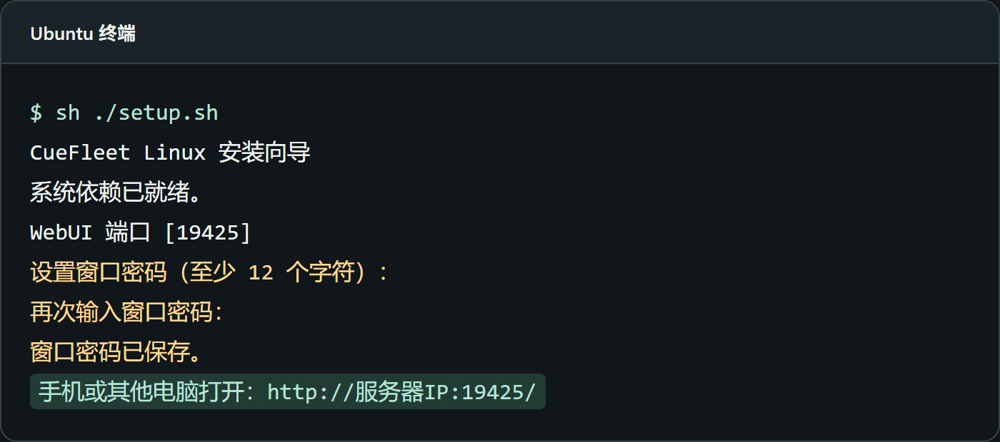
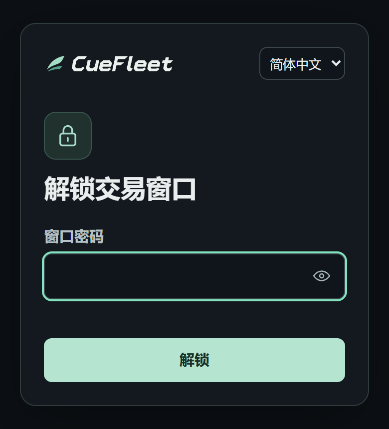
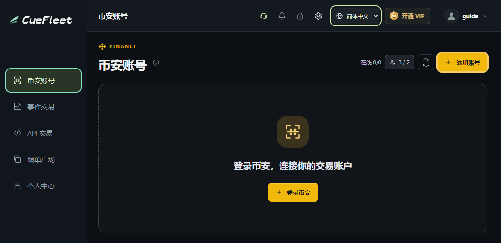
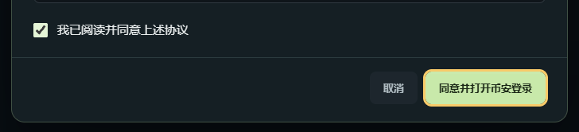

# Linux WebUI 使用教程

[English](linux.en.md) · [返回项目主页](../README.md)

支持 **Ubuntu 24.04（x86-64）**。在服务器安装，用电脑或手机浏览器打开。

## 1. 安装 CueFleet

用有 sudo 权限的普通用户登录服务器，在空目录运行。

```bash
curl -fL https://cuefleet.com/download/linux -o CueFleet-Linux-x64.tar.gz &&
tar -xzf CueFleet-Linux-x64.tar.gz &&
cd CueFleet-Linux-x64 &&
sh ./setup.sh
```

按向导设置窗口密码。启动后保持终端打开。



## 2. 在浏览器打开

用电脑或手机打开向导显示的地址，例如 `http://服务器公网IP:19425/`，输入窗口密码。默认端口是 `19425`。



在防火墙放行所选 TCP 端口，来源限于访问设备的公网 IP。**公网 HTTP 为明文传输。登录和交易请使用受信任的加密连接。**

## 3. 添加币安账号

用服务器本机浏览器打开 `http://127.0.0.1:19425/`，或用可信 HTTPS 远程访问时，点击「币安账号 → 添加账号」，同意协议后在窗口中完成币安官方登录。





<details>
<summary>配置 HTTPS（已有可信证书）</summary>

停止正在运行的客户端，将域名和证书路径替换成自己的配置，然后运行：

```bash
CUEFLEET_HTTPS_HOST=your-domain.example \
CUEFLEET_HTTPS_CERT=/path/to/fullchain.pem \
CUEFLEET_HTTPS_KEY=/path/to/privkey.pem \
sh ./start.sh
```

用 `https://你的域名:19425/` 打开。若使用自定义端口，启动和访问时沿用同一个端口。

</details>

升级与手动启动见安装包内的 `README.md`。
